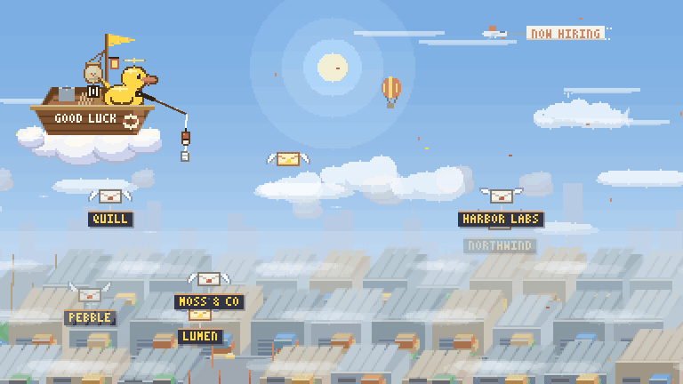

# GoodLuck Fishing

A calm fishing game. The letters are real jobs.

A tired yellow duck faints at its desk at 3:47 in the morning. Its soul rides a slow golden escalator up to HEAVEN's
pier, where a boat called GOOD LUCK is waiting. Out over a sky as clear as a lake, every letter flying up from the
city's roofs is a real job, posted in the last month. Cast, wait for a bite, reel it in: the better it fits your CV, the
brighter it shines. Then the same way home, and the letters waiting in the tray on the desk, to keep, to open, to apply
to.



**Play in your browser:** https://vinhdac.github.io/goodluck-fishing/ (a computer or a phone; no account).

**The app for Windows:** [GoodLuck Fishing on GitHub Releases](https://github.com/VinhDac/goodluck-fishing/releases/latest)
(coming out this week). The same game with a fleet of your own: each time you sail, it reads about 2,800 company job
boards live for your titles and your city, and checks each posting is still open before it bites.

## How it works

- **The jobs.** A few times a day a GitHub Action reads the public job boards of about 2,800 companies (Greenhouse,
  Lever, Ashby), found through Common Crawl (`tools/crawl.py`, `tools/harvest.py`). Recruitment agencies are left out.
  The jobs are written as one static file per part of the world on the `store` branch (`tools/publish.py`), which the
  game reads straight from GitHub.
- **The fit.** Pick what you fish for and play at once, with a typical CV of that field (the skills its postings ask
  most); drop your own CV any time. It is read in your browser (PDF by Mozilla's pdf.js, or pasted words) and never sent
  anywhere. Each posting's asks are weighed by how often it names them; the score is how much of that the CV speaks to
  (`js/score.js`).
- **The bucket.** Kept on your device. No account, no sign-in.
- **The app.** The same page in a window of its own (`app/`), with its fleet on your computer: Python's standard library
  and a webview. Your CV and your letters stay there.
- **The page.** Plain HTML, CSS and JavaScript, drawn in pixels on a canvas. No build step, no framework.

## Run it yourself

```
python -m http.server 8811
```

then open http://localhost:8811. The app: `python -m app`. The icons: `python tools/icons.py`. The share card and the
moving picture above are drawn from the game itself, by Chrome with no window: `python tools/card.py`, and
`python tools/card.py --moving` (which needs Pillow for the GIF). The rest of the tools are Python's standard library
alone.

Made by [Vinh Dac](https://vinhdac.github.io).
