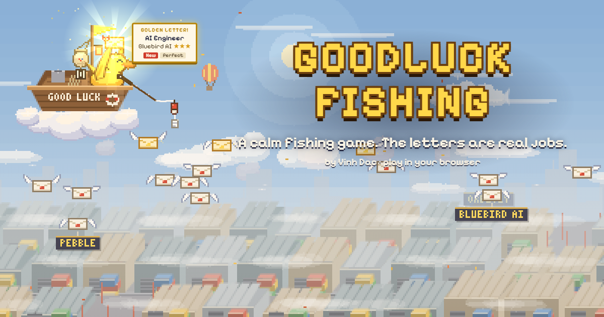

# GoodLuck Fishing

A tired yellow duck falls asleep at its desk after one more application. A golden escalator takes it up to the sky,
where every cloud is a real job, posted in the last month, and the bigger the cloud the better it fits your CV.
Fish for ten minutes a day; at sunset the bucket is your list: open each job, then press I applied, Expired or Not for me.

**Play:** https://vinhdac.github.io/goodluck-fishing/ (a computer or a phone; on a phone, add it to the home screen to
play full screen).



## How it works

- **The jobs.** Every six hours a GitHub Action reads the public job boards of about 2,800 companies (Greenhouse, Lever,
  Ashby), found through Common Crawl (`tools/crawl.py`, `tools/harvest.py`). Recruitment agencies are left out. The
  jobs are written as one static file per part of the world on the `store` branch (`tools/publish.py`), which the game
  reads straight from GitHub.
- **The fit.** Pick what you fish for and play at once, with a typical CV of that field (the skills its postings ask
  most); drop your own CV any time. It is read in your browser (PDF by Mozilla's pdf.js, or pasted words) and never sent
  anywhere. Each posting's asks are weighed by how often it names them; the score is how much of that the CV speaks to
  (`js/score.js`).
- **The bucket.** Kept on your device. No account, no sign-in.
- **The page.** Plain HTML, CSS and JavaScript, drawn in pixels on a canvas. No build step, no framework. The tools are
  Python's standard library alone.

## Run it yourself

```
python -m http.server 8811
```

then open http://localhost:8811. `python tools/icons.py` draws the icons and the share card from the game's own duck.

Made by [Vinh Dac](https://vinhdac.github.io).
